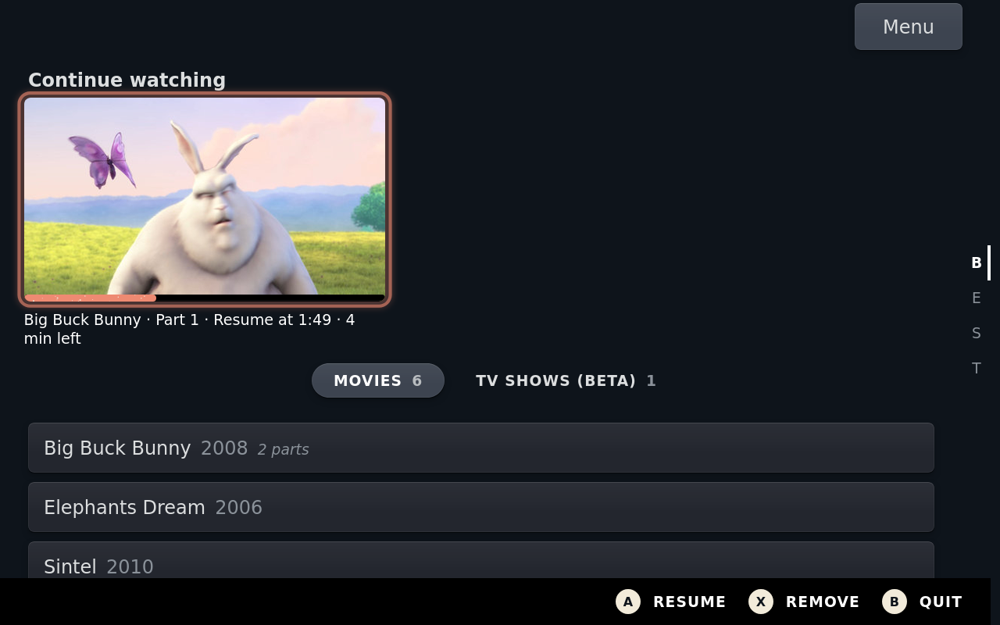
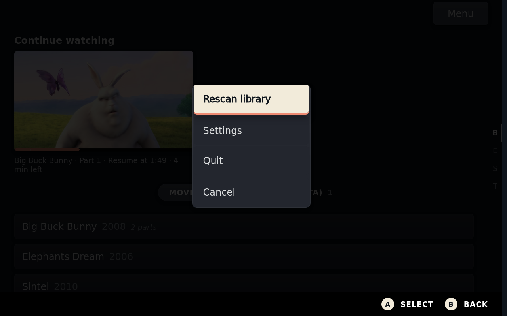
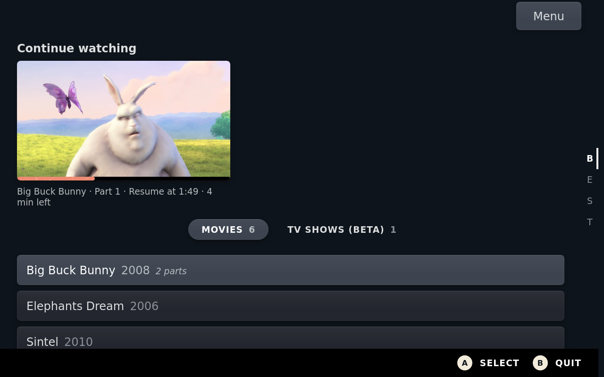
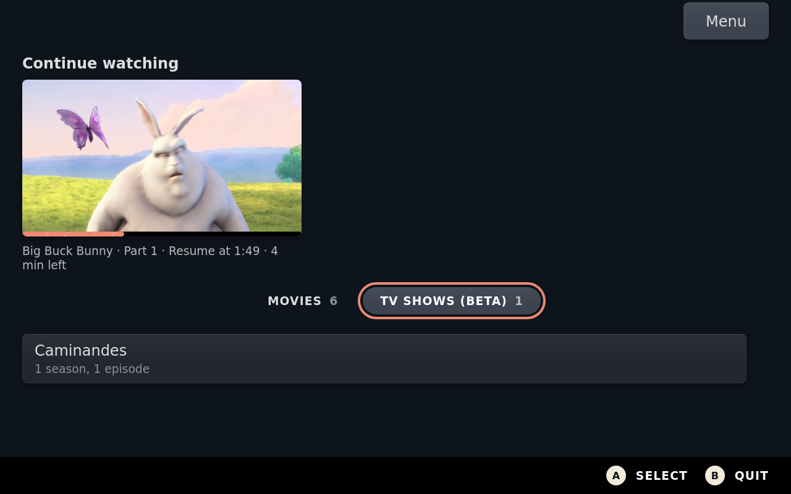
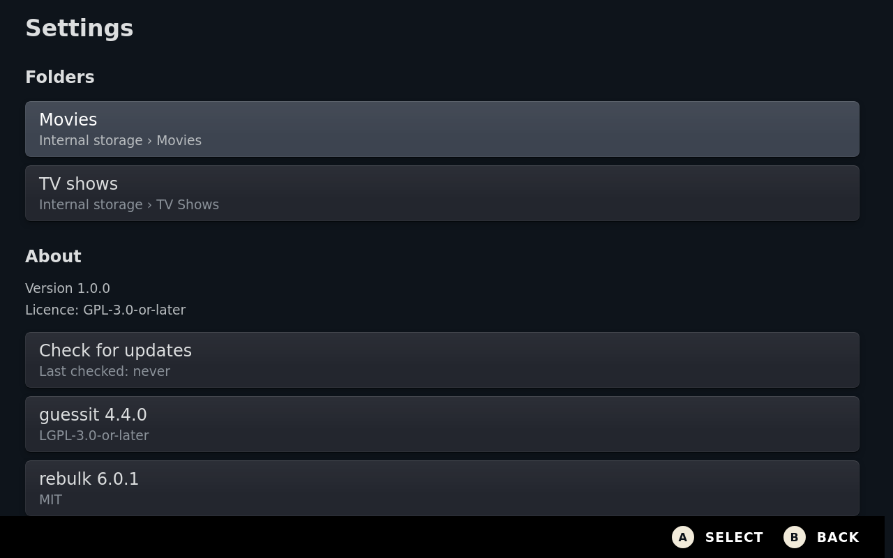

# Kettle Video

Kettle Video is a simple, controller-first way to browse and play the movies and TV shows you keep on your own handheld. It is for anyone with films on a SteamOS or Armada device who wants to pick one with the controller, in Gaming Mode, and have it play in mpv.



## Requirements

- A device running **SteamOS** or **Armada**, with Steam.
  - Other Linux systems with Steam may work but aren't tested. If you try one, reports are welcome through the [bug report form](https://github.com/enamelware/kettle-video/issues/new?template=bug_report.yml).
- **Firefox**, a system install or the Flatpak: Kettle Video shows its screens in Firefox, full screen.
- **mpv — not bundled.** Kettle Video plays films in mpv and finds it by itself, a system install or the Flatpak. If mpv is missing, the app says so and shows how to install the Flatpak (`flatpak install flathub io.mpv.Mpv`, or the Bazaar app store); press `q` to close it. On the first launch the same screen has a **Look again** button, so once mpv is installed you can carry on without restarting the app.
- Your films and shows in two folders, one for movies and one for TV shows, on the device or its SD card. Kettle Video only ever reads them.

## Installing

In Desktop Mode:

1. From the [latest release](https://github.com/enamelware/kettle-video/releases/latest), download one file: `install-kettle-video.desktop`.
2. Open your Downloads folder and double-click it (the file manager may show it as **Install Kettle Video**). It first warns that this is a program it doesn't know yet: choose **Continue** to run it.
3. Answer its questions. It says where Kettle Video goes and asks before going online, then downloads the latest release from GitHub, checks it, installs Kettle Video in your home folder, adds it to the app menu and checks for mpv. If mpv is missing, it offers to install it from Flathub and asks first.

It needs no password and never changes the system or Steam's own files. If anything goes wrong (no connection, GitHub can't be reached, or the download doesn't match its checksum), it says so and nothing is installed. Opened again on a device that already has Kettle Video, it says which version you have and which it will install; your library, settings and Continue watching are kept.

On the first launch Kettle Video checks for mpv, asks for your Movies and TV Shows folders, then reads them and shows what it found.

### Other ways to install

Without a connection on the device, or if you prefer a terminal: from the same release, download three files into one folder (for example Downloads): `install.sh`, `kettle-video-<version>.tar.gz` and `kettle-video-<version>.tar.gz.sha256`. Open a terminal (Konsole) in that folder and run:

```
bash install.sh
```

It does the same steps: it checks the download first, installs Kettle Video, adds it to the app menu and checks for mpv.

## Adding it to Steam

1. In Desktop Mode, open the app menu, find **Kettle Video** (under Multimedia), right-click it and choose **Add to Steam**.
2. In Gaming Mode, set the controller layout for it: Library, Kettle Video, the controller icon. Kettle Video works with keyboard keys, so each button is bound to a key: D-pad = arrows, A = Space, B = q, X = Backspace, Y = a, L1 = j, R1 = l, Start = m, and the left stick left and right = arrows. Step-by-step: [`docs/device-setup.md`](docs/device-setup.md), "Controller layout".

## Controls

On Home:

- **D-pad up and down:** move through Continue watching, the tabs and the list.
- **D-pad left and right:** switch between Movies and TV Shows, jump by letter in the Movies list, and move between Continue watching tiles.
- **A:** play the film, or open a show's episodes.
- **X:** take a tile off Continue watching.
- **Start:** open the menu (Rescan library, Settings, Quit).
- **B:** open the menu with Quit selected; B again closes it. Inside a show, B goes back.

To quit, choose **Quit** in the menu (`q` or B opens it with Quit chosen; press Enter or A).



While a film plays:

- **A:** play or pause.
- **B:** stop and go back to Kettle Video, keeping your place.
- **D-pad left and right** (and the left stick): back or forward 10 seconds. **L1 and R1:** back or forward 1 minute.
- **X:** next subtitle track, then off. **Y:** next audio track.
- **D-pad up:** show the title, the time and the progress bar.

Films continue where you stopped them, and whatever you're partway through sits at the top under **Continue watching**, with the frame where you stopped.



More detail, from resume to keeping the screen on: [`docs/user-guide.md`](docs/user-guide.md).

## TV shows (beta)

**TV shows are in beta**: the tab says "TV Shows (beta)". Today the tab lists your shows, grouped by show, season and episode from the file names. Choosing a show opens one list of its episodes, with season headings when it has more than one season, and any episode plays from there. Separate show, season and episode screens come later.



## Settings

Open the menu and choose **Settings**:

- **Folders:** change where your movies or TV shows are, or stop using one of them.
- **About:** the version, the licence, every third-party credit, and **Check for updates**.

Your settings are kept in `~/.config/kettle-video/settings.json` and your saved library in `~/.local/share/kettle-video/data`; the logs are below, under [Logs](#logs).



## Updating

From inside the app: open **Settings**, then **Check for updates**. When a newer version is out, choose **Update and restart** and say yes. Kettle Video downloads it, installs it and restarts by itself, without leaving Gaming Mode. Your library, settings, resume positions and Continue watching stay as they are, and if the new version doesn't start cleanly, the one you had comes back. It never updates by itself.

## Uninstalling

In Desktop Mode, open a terminal (Konsole) and run:

```
bash ~/.local/share/kettle-video/app/installer/uninstall.sh
```

It lists what it will remove and asks first. It keeps your library, resume positions, settings and logs unless you ask it to delete them, and never touches your films, mpv itself or Steam's files. If you do delete them, installing Kettle Video again starts from scratch, as a first launch. A development copy (a git folder) keeps its own data, browser profile and resume positions, so uninstalling never touches it. Then remove Kettle Video from Steam by hand: right-click it in your Steam Library, **Manage**, **Remove non-Steam game from your library**.

## Privacy

Kettle Video collects nothing and never goes online by itself. The only time it connects is when you choose **Check for updates** in Settings › About: it then asks GitHub for the latest version, which shows GitHub your IP address and the app's version, and, if you then choose **Update and restart**, downloads the new version from GitHub. It sends nothing about you or your library. Your library, settings and watch history stay on your device.

- On a development copy (a git folder), the same two actions ask that copy's own git remote instead: **Check for updates** reads its latest version and **Pull the latest version** downloads it. git connects with its own settings, including any sign-in you have set up for that remote, so the remote can see which account is asking.
- Also on a development copy only, **Try a branch** in Settings › About goes online when you choose it: git lists the branches on the copy's remote, and Kettle Video asks GitHub for this project's open pull requests (no sign-in, which shows GitHub your IP address and the app's version); choosing a branch then downloads that branch with git. **Back to main** and **Restore data from before the last switch** never go online. The backups made before each switch stay in that copy's own data folder.
- The window Kettle Video opens in has a Firefox profile of its own, with Firefox's own updates, telemetry and other online features switched off. An installed copy and a development copy each have their own.
- The one-file installer (`install-kettle-video.desktop`) goes online only after you open it and say yes: it asks GitHub for the latest release and downloads it from this project's GitHub releases, which shows GitHub your IP address. It sends nothing about you.
- The installer goes online only if mpv is missing and you say yes to installing it from Flathub.

Any future feature that needs the network will only run when you choose it, and this section will say so first.

## Reporting a bug

[Open a new issue](https://github.com/enamelware/kettle-video/issues/new/choose) on GitHub and choose **Bug report**. It asks for your device, its system and version, Desktop or Gaming Mode, the Kettle Video version (Settings › About shows it) and what happened. Please leave out personal file and folder names, and attach the logs below if you can.

## Logs

Each run writes three logs in `~/.local/state/kettle-video/logs`: `launch-<timestamp>.log` (starting the app), `firefox-<timestamp>.log` (the window) and one `mpv-<timestamp>.log` per file played, which names that file. If Kettle Video can't start, it says so on screen, with what to do and the name of the log to attach.

## Licence

Kettle Video is free software under the GNU General Public License v3.0 or later (GPL-3.0-or-later); see [`LICENSE`](LICENSE). The third-party code it bundles, and mpv, which it uses but doesn't bundle, are listed with their licences in [`THIRD_PARTY_LICENSES.md`](THIRD_PARTY_LICENSES.md) and in Settings › About.

Outside code contributions aren't being accepted for now, but bug reports and feedback are welcome. How the project is built: [How this repo is built](docs/how-this-repo-is-built.md); developing it: [`docs/dev-environment.md`](docs/dev-environment.md); making a release: [`docs/RELEASING.md`](docs/RELEASING.md).

## Screenshot credits

The screenshots show Kettle Video playing from a library of Blender open movies. The pictures and titles in them come from these films:

| Film | Credit | Licence |
|---|---|---|
| Big Buck Bunny (2008) | (CC) Blender Foundation \| studio.blender.org | [CC BY 3.0](https://creativecommons.org/licenses/by/3.0/) |
| Elephants Dream (2006) | (CC) Blender Foundation \| studio.blender.org | [CC BY 2.5](https://creativecommons.org/licenses/by/2.5/) |
| Sintel (2010) | (CC) Blender Foundation \| studio.blender.org | [CC BY 3.0](https://creativecommons.org/licenses/by/3.0/) |
| Caminandes 2: Gran Dillama (2013) | (CC) Blender Foundation \| studio.blender.org | [CC BY 4.0](https://creativecommons.org/licenses/by/4.0/) |

The screenshots are frames and titles from these films shown in Kettle Video, so they are under the films' licences above, not under Kettle Video's GPL. Kettle Video is not affiliated with or endorsed by the Blender Foundation. More in [`docs/screenshots/README.md`](docs/screenshots/README.md).

---

Kettle Video is not affiliated with Valve. Steam and Steam Deck are trademarks of Valve Corporation.
